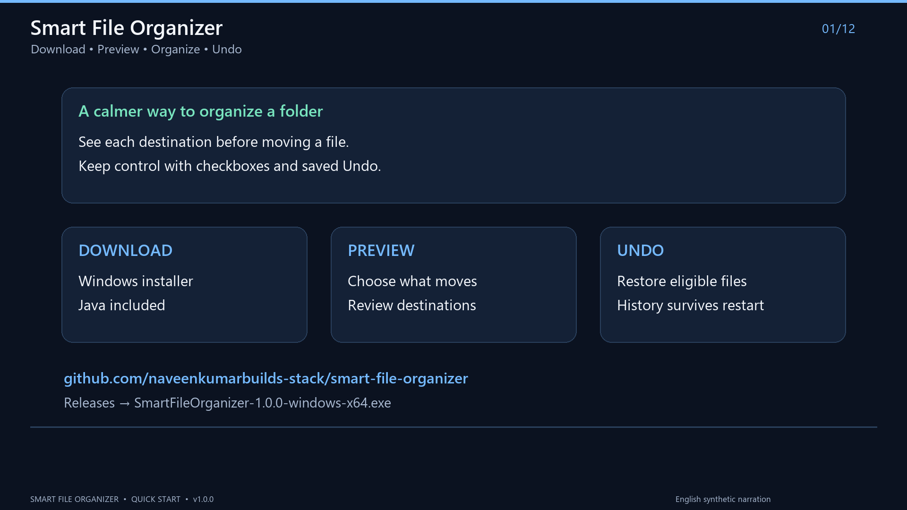
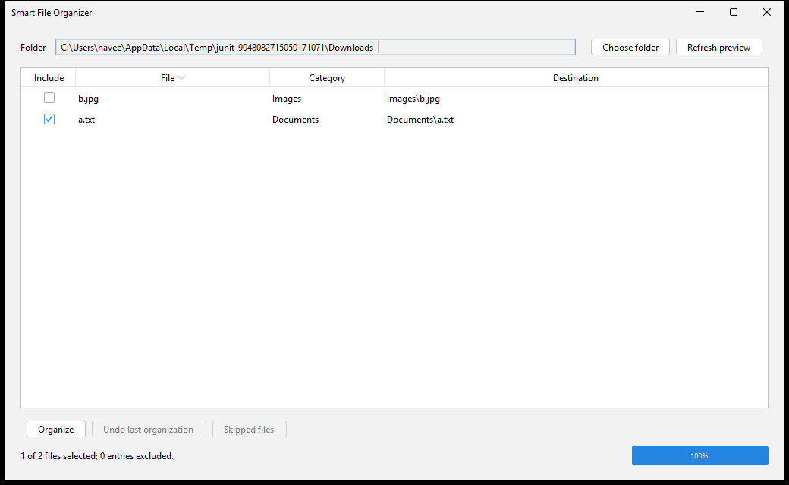

# Smart File Organizer

An offline Windows desktop app for reviewing file moves, organizing a folder, and undoing the last organization after a restart.

Choose a folder, review the proposed destinations, and select which files to include. Smart File Organizer groups files by extension into Images, Documents, Videos, Audio, Archives, Installers, Code, and Others.

## Features

- Preview every proposed move and exclude individual files.
- Sort the preview table by filename, category, or destination.
- Reserve duplicate names with suffixes such as `photo (1).jpg`.
- Save the last batch's undo history on disk.
- Skip hidden, system, read-only, temporary download, linked, and unavailable files.
- Keep the window responsive during scans and moves.
- Remember the last successfully previewed folder.
- Show moved, skipped, and failed counts, with detailed application logs.

## Video guide

[](https://github.com/naveenkumarbuilds-stack/smart-file-organizer/releases/download/v1.0.0/SmartFileOrganizer-QuickStart.mp4)

A 3 minute 20 second guide with English synthetic narration and on-screen captions. It combines actual GitHub/app screens with illustrated installation, result, and undo steps.

[Download the MP4](https://github.com/naveenkumarbuilds-stack/smart-file-organizer/releases/download/v1.0.0/SmartFileOrganizer-QuickStart.mp4) · [Download captions](https://github.com/naveenkumarbuilds-stack/smart-file-organizer/releases/download/v1.0.0/SmartFileOrganizer-QuickStart.srt) · [Read the transcript](docs/quick-start-video.md)

## Screenshot



Captured from the desktop integration test using temporary sample files.

## Install on Windows

The packaged application targets Windows 10/11 x64.

1. Open the [GitHub Releases page](https://github.com/naveenkumarbuilds-stack/smart-file-organizer/releases).
2. Download `SmartFileOrganizer-1.0.0-windows-x64.exe` for version 1.0.0.
3. Run the installer and launch SmartFileOrganizer from the Start menu.

The installer includes Java 21 and installs for the current Windows user. This build is unsigned, so Windows may display an unknown-publisher message.

For a local build, the installer is in `dist/1.0.0/`. The [Windows release workflow](.github/workflows/release.yml) builds downloadable releases from version tags.

## Usage

1. Try the app on a throwaway folder containing copies of sample files.
2. Click **Choose folder** and select that folder.
3. Review the **File**, **Category**, and **Destination** columns.
4. Uncheck files you want to leave in place. **Skipped files** explains scan exclusions.
5. Click **Organize** and confirm the selected file and destination-folder counts.
6. Read the result summary.
7. Click **Undo last organization** to restore eligible files from the saved batch.

Closing and reopening the app retains the undo history. The last selected folder is previewed automatically when it remains available.

Starting another organization replaces the previous batch's undo history when the new batch is journaled. Resolve any outstanding undo work before organizing another batch.

## File handling

Only regular files directly inside the selected folder become sources. Existing category directories are inspected to reserve destination names. Files inside those directories or other subfolders are excluded from source scanning.

Extension matching ignores case. Unknown extensions and names without an extension go to Others. Classification uses the filename rather than inspecting content.

The app refuses drive roots, the user's home folder itself, and protected Windows system/application trees. It skips `.crdownload`, `.part`, and `.tmp` files and excludes its undo journal.

If a destination becomes occupied after preview, the row is skipped. Refresh the preview to calculate a new available name.

Undo checks the saved file identity, timestamps, and content fingerprint. Changed or missing files and occupied original locations are skipped, with unresolved entries retained for retry. Empty category folders remain after undo.

Lock detection depends on the operating system and other applications. Files can change between preview and execution. The app rechecks eligibility before each move. v1 uses same-filesystem moves and skips cross-filesystem destinations.

## Build from source

Install JDK 21 and Maven, then open a terminal in the project directory.

```powershell
java -version
mvn -version
mvn clean verify
java -jar target/smart-file-organizer.jar
```

The first build downloads dependencies and requires internet. The application runs offline.

The project uses Java 21, Maven, Swing, FlatLaf, Gson, and JUnit 5. On a Windows desktop, the current suite contains 98 tests. Platform-specific and desktop tests may be skipped on other or headless systems.

## Build the Windows installer

Use Windows x64 with a full JDK 21, Maven, and WiX 3.x. Set `JAVA_HOME` to the JDK and place Maven and WiX binaries on PATH, or supply the script parameters.

```powershell
.\scripts\package-windows.ps1
```

The script runs Maven verification, creates a bundled-runtime application image, opens and closes the packaged launcher with isolated settings, and creates the installer, JAR, and `SHA256SUMS.txt`.

Outputs go to `dist/<numeric POM version>/`. Move an existing version directory aside before rebuilding it. The script refuses to replace existing outputs.

See the [packaging guide](docs/phase-7.md) for explicit tool paths, version rules, and release instructions.

## Settings and logs

On Windows, application data normally lives in:

```text
%LOCALAPPDATA%\SmartFileOrganizer\
  settings.json
  undo.json
  organizer-0.log
```

Logs rotate across three files of about 1 MB each. The app also creates lock files while coordinating journal access. Settings and undo history are separate.

Logs and the undo journal can contain full file paths. Review them before sharing them in public issues. Preserve `undo.json` if recovery is needed.

## FAQ

### Why is Organize disabled?

Choose a valid folder, wait for the preview, and include at least one file. Organize is also disabled if the saved undo history cannot be read.

### Why was a file skipped?

It may be hidden, protected, read-only, temporary, linked, in use, or unavailable. Its destination may also have changed since preview. Check **Skipped files** and the application log.

### Why did Undo skip a file?

The moved file may have changed or disappeared, or its original location may be occupied. Check the conflict and retry. Editing a moved file can make it ineligible for automatic undo.

### Does the Windows installer require Java?

The installer bundles Java. Running the standalone JAR requires Java 21 or newer. The release build is verified on Java 21.

### Is an internet connection required?

The installed application works offline. Downloading the app and building it for the first time require internet.

### Can I customize categories or scan subfolders?

The current version uses the default extension mapping and direct-child scanning. Custom rules, recursive scanning, scheduling, cloud features, and a dark-mode toggle are outside v1.

### What has been verified?

All 98 tests passed on Java 21. The runnable JAR and Windows EXE were built, and the packaged application opened and closed using its bundled runtime. Installer installation, installed-app launch, and uninstallation were also verified in an isolated project folder. Upgrade testing was blocked by Windows Application Control. Both GitHub build and release workflows passed, and version 1.0.0 is published. A separate Windows 10 compatibility run remains unverified. See the [final local review](docs/final-review.md) for the audit results.

## Contributing

See [CONTRIBUTING.md](CONTRIBUTING.md) for setup, tests, pull requests, and the project's file-safety requirements. Use the repository's issue forms for bugs and feature requests.

## License

Smart File Organizer is licensed under the [MIT License](LICENSE), copyright 2026 Smart File Organizer contributors.

Third-party components retain their own licenses. See [THIRD_PARTY_NOTICES.md](THIRD_PARTY_NOTICES.md).
