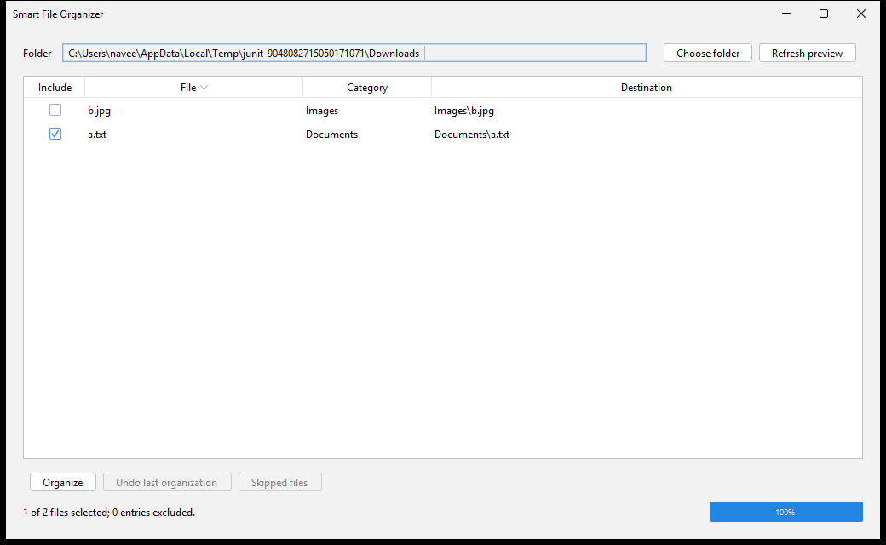

# Phase 8 — Open-source documentation

## 1. Goal
Explain installation, daily use, recovery limits, and source builds. Provide an MIT license, contribution guidance, an actual screenshot, and structured GitHub issue forms.

## 2. Files
- C:\Users\navee\OneDrive\Desktop\opensorceproject\README.md
- C:\Users\navee\OneDrive\Desktop\opensorceproject\LICENSE
- C:\Users\navee\OneDrive\Desktop\opensorceproject\CONTRIBUTING.md
- C:\Users\navee\OneDrive\Desktop\opensorceproject\THIRD_PARTY_NOTICES.md
- C:\Users\navee\OneDrive\Desktop\opensorceproject\licenses\Apache-2.0.txt
- C:\Users\navee\OneDrive\Desktop\opensorceproject\.github\ISSUE_TEMPLATE\bug_report.yml
- C:\Users\navee\OneDrive\Desktop\opensorceproject\.github\ISSUE_TEMPLATE\feature_request.yml
- C:\Users\navee\OneDrive\Desktop\opensorceproject\.github\ISSUE_TEMPLATE\config.yml
- C:\Users\navee\OneDrive\Desktop\opensorceproject\pom.xml
- C:\Users\navee\OneDrive\Desktop\opensorceproject\docs\images\preview.png

## 3. Complete contents

### README.md

````markdown
# Smart File Organizer

An offline Windows desktop app for reviewing file moves, organizing a folder, and undoing the last organization after a restart.

Choose a folder, review the proposed destinations, and select which files to include. Smart File Organizer groups files by extension into Images, Documents, Videos, Audio, Archives, Installers, Code, and Others.

## Features

- Preview every proposed move and exclude individual files.
- Sort the preview table by filename, category, or destination.
- Reserve duplicate names with suffixes such as `photo (1).jpg`.
- Save the last batch's undo history on disk.
- Skip hidden, system, read-only, temporary download, linked, and unavailable files.
- Keep the window responsive during scans and moves.
- Remember the last successfully previewed folder.
- Show moved, skipped, and failed counts, with detailed application logs.

## Screenshot


Captured from the desktop integration test using temporary sample files.

## Install on Windows

The packaged application targets Windows 10/11 x64.

1. Open this repository's **Releases** page when a release is available.
2. Download `SmartFileOrganizer-1.0.0-windows-x64.exe` for version 1.0.0.
3. Run the installer and launch SmartFileOrganizer from the Start menu.

The installer includes Java 21 and installs for the current Windows user. This build is unsigned, so Windows may display an unknown-publisher message.

For a local build, the installer is in `dist/1.0.0/`. GitHub publication has not been performed from this workspace. The GitHub workflow files are prepared for repository setup.

## Usage

1. Try the app on a throwaway folder containing copies of sample files.
2. Click **Choose folder** and select that folder.
3. Review the **File**, **Category**, and **Destination** columns.
4. Uncheck files you want to leave in place. **Skipped files** explains scan exclusions.
5. Click **Organize** and confirm the selected file and destination-folder counts.
6. Read the result summary.
7. Click **Undo last organization** to restore eligible files from the saved batch.

Closing and reopening the app retains the undo history. The last selected folder is previewed automatically when it remains available.

Starting another organization replaces the previous batch's undo history when the new batch is journaled. Resolve any outstanding undo work before organizing another batch.

## File handling

Only regular files directly inside the selected folder become sources. Existing category directories are inspected to reserve destination names. Files inside those directories or other subfolders are excluded from source scanning.

Extension matching ignores case. Unknown extensions and names without an extension go to Others. Classification uses the filename rather than inspecting content.

The app refuses drive roots, the user's home folder itself, and protected Windows system/application trees. It skips `.crdownload`, `.part`, and `.tmp` files and excludes its undo journal.

If a destination becomes occupied after preview, the row is skipped. Refresh the preview to calculate a new available name.

Undo checks the saved file identity, timestamps, and content fingerprint. Changed or missing files and occupied original locations are skipped, with unresolved entries retained for retry. Empty category folders remain after undo.

Lock detection depends on the operating system and other applications. Files can change between preview and execution. The app rechecks eligibility before each move. v1 uses same-filesystem moves and skips cross-filesystem destinations.

## Build from source

Install JDK 21 and Maven, then open a terminal in the project directory.

```powershell
java -version
mvn -version
mvn clean verify
java -jar target/smart-file-organizer.jar
```

The first build downloads dependencies and requires internet. The application runs offline.

The project uses Java 21, Maven, Swing, FlatLaf, Gson, and JUnit 5. On a Windows desktop, the current suite contains 91 tests. Platform-specific and desktop tests may be skipped on other or headless systems.

## Build the Windows installer

Use Windows x64 with a full JDK 21, Maven, and WiX 3.x. Set `JAVA_HOME` to the JDK and place Maven and WiX binaries on PATH, or supply the script parameters.

```powershell
.\scripts\package-windows.ps1
```

The script runs Maven verification, creates a bundled-runtime application image, opens and closes the packaged launcher with isolated settings, and creates the installer, JAR, and `SHA256SUMS.txt`.

Outputs go to `dist/<numeric POM version>/`. Move an existing version directory aside before rebuilding it. The script refuses to replace existing outputs.

See the [packaging guide](docs/phase-7.md) for explicit tool paths, version rules, and release instructions.

## Settings and logs

On Windows, application data normally lives in:

```text
%LOCALAPPDATA%\SmartFileOrganizer\
  settings.json
  undo.json
  organizer-0.log
```

Logs rotate across three files of about 1 MB each. The app also creates lock files while coordinating journal access. Settings and undo history are separate.

Logs and the undo journal can contain full file paths. Review them before sharing them in public issues. Preserve `undo.json` if recovery is needed.

## FAQ

### Why is Organize disabled?

Choose a valid folder, wait for the preview, and include at least one file. Organize is also disabled if the saved undo history cannot be read.

### Why was a file skipped?

It may be hidden, protected, read-only, temporary, linked, in use, or unavailable. Its destination may also have changed since preview. Check **Skipped files** and the application log.

### Why did Undo skip a file?

The moved file may have changed or disappeared, or its original location may be occupied. Check the conflict and retry. Editing a moved file can make it ineligible for automatic undo.

### Does the Windows installer require Java?

The installer bundles Java. Running the standalone JAR requires Java 21 or newer. The release build is verified on Java 21.

### Is an internet connection required?

The installed application works offline. Downloading the app and building it for the first time require internet.

### Can I customize categories or scan subfolders?

The current version uses the default extension mapping and direct-child scanning. Custom rules, recursive scanning, scheduling, cloud features, and a dark-mode toggle are outside v1.

### What has been verified?

All 91 tests passed on Java 21. The runnable JAR and Windows EXE were built, and the packaged application opened and closed using its bundled runtime. Installer installation/uninstallation, upgrade behavior, GitHub workflow execution, and a Windows 10 compatibility run remain unverified.

## Contributing

See [CONTRIBUTING.md](CONTRIBUTING.md) for setup, tests, pull requests, and the project's file-safety requirements. Use the repository's issue forms for bugs and feature requests.

## License

Smart File Organizer is licensed under the [MIT License](LICENSE), copyright 2026 Smart File Organizer contributors.

Third-party components retain their own licenses. See [THIRD_PARTY_NOTICES.md](THIRD_PARTY_NOTICES.md).
````

### LICENSE

````text
MIT License

Copyright (c) 2026 Smart File Organizer contributors

Permission is hereby granted, free of charge, to any person obtaining a copy
of this software and associated documentation files (the "Software"), to deal
in the Software without restriction, including without limitation the rights
to use, copy, modify, merge, publish, distribute, sublicense, and/or sell
copies of the Software, and to permit persons to whom the Software is
furnished to do so, subject to the following conditions:

The above copyright notice and this permission notice shall be included in all
copies or substantial portions of the Software.

THE SOFTWARE IS PROVIDED "AS IS", WITHOUT WARRANTY OF ANY KIND, EXPRESS OR
IMPLIED, INCLUDING BUT NOT LIMITED TO THE WARRANTIES OF MERCHANTABILITY,
FITNESS FOR A PARTICULAR PURPOSE AND NONINFRINGEMENT. IN NO EVENT SHALL THE
AUTHORS OR COPYRIGHT HOLDERS BE LIABLE FOR ANY CLAIM, DAMAGES OR OTHER
LIABILITY, WHETHER IN AN ACTION OF CONTRACT, TORT OR OTHERWISE, ARISING FROM,
OUT OF OR IN CONNECTION WITH THE SOFTWARE OR THE USE OR OTHER DEALINGS IN THE
SOFTWARE.
````

### CONTRIBUTING.md

````markdown
# Contributing to Smart File Organizer

Small fixes, clear bug reports, documentation improvements, and focused pull requests are welcome.

## Set up the project

Use JDK 21 and Maven. Fork the repository, clone your fork using its GitHub **Code** button, and create a branch for your change.

From the project directory:

```powershell
java -version
mvn -version
mvn clean verify
java -jar target/smart-file-organizer.jar
```

Use temporary files or disposable copies for every manual organization and undo check.

## Understand the structure

| Location | Responsibility |
| --- | --- |
| `model/` | Categories and immutable move/result values |
| `core/` | Classification, safety, scanning, planning, moving, undo, and the application service |
| `storage/` | Settings and persistent undo history |
| `ui/` | Swing window, table model, and friendly error messages |
| `src/test/java/` | JUnit 5 tests, including temporary-file and desktop flows |
| `scripts/` | Windows packaging and packaged-launcher verification |
| `.github/workflows/` | Build verification and tag-triggered releases |

All application packages are under `com.smartfileorganizer`.

## File-safety requirements

- Use Java NIO paths and file operations. Keep Swing imports in the UI layer.
- Keep move planning deterministic and free of filesystem access.
- Show planned destinations before executing moves.
- Preserve destination collision checks and per-file failure handling.
- Persist each move intention before starting the move, then record completion.
- Preserve pending journal entries when the outcome is uncertain.
- Undo only when the moved file matches its saved fingerprint and the original path is free.
- Retain unresolved undo entries for retry.
- Preserve settings and journal compatibility, or provide an explicit migration.
- Run disk work outside the Swing event thread.
- Keep journal access serialized across application instances.
- Keep the default extension mapping in `FileCategory`.

Discuss changes involving file operations or journal semantics in an issue before starting a large implementation.

## Tests

Run:

```powershell
mvn clean verify
```

Use JUnit 5 and `@TempDir` for filesystem tests. Add regression coverage for a concrete bug or a new behavior. Cover partial failure and retry when changing moves or undo.

The desktop integration test briefly opens windows and uses temporary data. It verifies folder selection, sorting, row exclusion, organization, undo, and reopening the saved folder. The GUI test is skipped in headless environments.

Tests for DOS hidden/system/read-only attributes run on Windows. The Windows desktop suite currently contains 91 tests.

## Pull requests

Keep each pull request focused. Explain the user-visible change, the reason for it, and how you verified it. Include screenshots for interface changes and mention any compatibility or recovery implications.

Add Javadoc for public classes and methods. Prefer readable code, small methods, and existing project helpers. Avoid introducing libraries unless they solve a concrete need.

Generated `target/`, `dist/`, and `.build-tools/` directories are excluded from Git. Commit source files, documentation, and intentional screenshot assets.

Contributions are provided under this project's MIT License. Retain upstream copyright and license notices for reused third-party code.

## Report a bug

Use the bug report form in the repository's **Issues** tab. Include the app version, Windows version, launch method, expected behavior, actual behavior, and a reproducible example using dummy files.

For a move or undo failure, preserve the journal and affected files. Share filenames and a directory outline after removing private information. Logs and `undo.json` can contain full paths, so review attachments before posting.

## Suggest a feature

Use the feature request form and describe the user's problem, a concrete example, and the expected preview/undo behavior. Custom rules, recursive scanning, scheduling, cloud features, and a dark-mode toggle are outside v1 and need a scope discussion.

## Maintainer release steps

1. Review the current verification limits in the README.
2. Set the POM version and confirm the numeric version follows Windows installer limits.
3. Run `mvn clean verify` on a Windows desktop using Java 21.
4. Build with `scripts/package-windows.ps1` and review the packaged-launcher result.
5. Check that the JAR contains the project license and dependency notices.
6. Verify installer installation, launch, uninstall, and upgrade behavior on disposable Windows 10/11 environments.
7. Run **Windows release** manually on GitHub to review its artifacts.
8. Push the matching version tag when the release is ready. For numeric version 1.0.0, the tag is `v1.0.0`.

Pushing a version tag starts the release workflow and publishes files after a successful build. The workflow's publication step requires repository content-write permission. Retain the fixed Windows upgrade UUID across releases.
````

### THIRD_PARTY_NOTICES.md

````markdown
# Third-party notices

Smart File Organizer's own source code is licensed under MIT. The following components retain their upstream copyrights and license terms.

## Application dependencies

| Component | Version | Upstream | License |
| --- | --- | --- | --- |
| FlatLaf | 3.6 | FormDev Software GmbH and contributors | Apache License 2.0 |
| Gson | 2.13.1 | Google and contributors | Apache License 2.0 |
| Error Prone annotations | 2.38.0 | Google and contributors | Apache License 2.0 |

Error Prone annotations are brought in by Gson's Maven dependency graph and included in the shaded JAR.

The Apache License 2.0 text is included in [licenses/Apache-2.0.txt](licenses/Apache-2.0.txt). The built JAR contains this file under `META-INF/smart-file-organizer/licenses/`, together with this notice and the project's MIT license. FlatLaf's original embedded license is also retained under `META-INF/LICENSE`.

Upstream source and license references:

- [FlatLaf 3.6](https://github.com/JFormDesigner/FlatLaf/tree/3.6)
- [Gson 2.13.1 license](https://github.com/google/gson/blob/gson-parent-2.13.1/LICENSE)
- [Error Prone 2.38.0 license](https://github.com/google/error-prone/blob/v2.38.0/COPYING)

## Bundled Java runtime

The Windows installer built in this workspace bundles Eclipse Temurin 21.0.13+9, produced from OpenJDK. Its primary license is GPL version 2 with the Classpath Exception. Runtime components also include additional notices and licenses.

The bundled runtime retains its `runtime/legal/` directory, including per-module license files, the Classpath Exception, and third-party notices. Consult those files for the runtime's complete terms.

The runtime's upstream source repository is [adoptium/jdk21u](https://github.com/adoptium/jdk21u). The runtime release metadata identifies source revision `2ab10ca20c19` and build-source revision `1cf43d7a3e77886bfea7d550a902e151a87d724d`.

[Temurin 21 binary and source releases](https://github.com/adoptium/temurin21-binaries/releases) provide the corresponding distribution downloads. Future builds may use a newer Java 21 update. Check that build's runtime `release` metadata and retained `legal/` files.

## Development tools

JUnit 5 is used for tests and is excluded from the application JAR. Maven, WiX, and the full JDK are build tools. Their original distributions and license terms apply to those tools.

- [JUnit 5](https://github.com/junit-team/junit5)
- [Apache Maven](https://maven.apache.org/)
- [WiX Toolset](https://github.com/wixtoolset/wix3)
````

### licenses/Apache-2.0.txt

````text
                                 Apache License
                           Version 2.0, January 2004
                        http://www.apache.org/licenses/

   TERMS AND CONDITIONS FOR USE, REPRODUCTION, AND DISTRIBUTION

   1. Definitions.

      "License" shall mean the terms and conditions for use, reproduction,
      and distribution as defined by Sections 1 through 9 of this document.

      "Licensor" shall mean the copyright owner or entity authorized by
      the copyright owner that is granting the License.

      "Legal Entity" shall mean the union of the acting entity and all
      other entities that control, are controlled by, or are under common
      control with that entity. For the purposes of this definition,
      "control" means (i) the power, direct or indirect, to cause the
      direction or management of such entity, whether by contract or
      otherwise, or (ii) ownership of fifty percent (50%) or more of the
      outstanding shares, or (iii) beneficial ownership of such entity.

      "You" (or "Your") shall mean an individual or Legal Entity
      exercising permissions granted by this License.

      "Source" form shall mean the preferred form for making modifications,
      including but not limited to software source code, documentation
      source, and configuration files.

      "Object" form shall mean any form resulting from mechanical
      transformation or translation of a Source form, including but
      not limited to compiled object code, generated documentation,
      and conversions to other media types.

      "Work" shall mean the work of authorship, whether in Source or
      Object form, made available under the License, as indicated by a
      copyright notice that is included in or attached to the work
      (an example is provided in the Appendix below).

      "Derivative Works" shall mean any work, whether in Source or Object
      form, that is based on (or derived from) the Work and for which the
      editorial revisions, annotations, elaborations, or other modifications
      represent, as a whole, an original work of authorship. For the purposes
      of this License, Derivative Works shall not include works that remain
      separable from, or merely link (or bind by name) to the interfaces of,
      the Work and Derivative Works thereof.

      "Contribution" shall mean any work of authorship, including
      the original version of the Work and any modifications or additions
      to that Work or Derivative Works thereof, that is intentionally
      submitted to Licensor for inclusion in the Work by the copyright owner
      or by an individual or Legal Entity authorized to submit on behalf of
      the copyright owner. For the purposes of this definition, "submitted"
      means any form of electronic, verbal, or written communication sent
      to the Licensor or its representatives, including but not limited to
      communication on electronic mailing lists, source code control systems,
      and issue tracking systems that are managed by, or on behalf of, the
      Licensor for the purpose of discussing and improving the Work, but
      excluding communication that is conspicuously marked or otherwise
      designated in writing by the copyright owner as "Not a Contribution."

      "Contributor" shall mean Licensor and any individual or Legal Entity
      on behalf of whom a Contribution has been received by Licensor and
      subsequently incorporated within the Work.

   2. Grant of Copyright License. Subject to the terms and conditions of
      this License, each Contributor hereby grants to You a perpetual,
      worldwide, non-exclusive, no-charge, royalty-free, irrevocable
      copyright license to reproduce, prepare Derivative Works of,
      publicly display, publicly perform, sublicense, and distribute the
      Work and such Derivative Works in Source or Object form.

   3. Grant of Patent License. Subject to the terms and conditions of
      this License, each Contributor hereby grants to You a perpetual,
      worldwide, non-exclusive, no-charge, royalty-free, irrevocable
      (except as stated in this section) patent license to make, have made,
      use, offer to sell, sell, import, and otherwise transfer the Work,
      where such license applies only to those patent claims licensable
      by such Contributor that are necessarily infringed by their
      Contribution(s) alone or by combination of their Contribution(s)
      with the Work to which such Contribution(s) was submitted. If You
      institute patent litigation against any entity (including a
      cross-claim or counterclaim in a lawsuit) alleging that the Work
      or a Contribution incorporated within the Work constitutes direct
      or contributory patent infringement, then any patent licenses
      granted to You under this License for that Work shall terminate
      as of the date such litigation is filed.

   4. Redistribution. You may reproduce and distribute copies of the
      Work or Derivative Works thereof in any medium, with or without
      modifications, and in Source or Object form, provided that You
      meet the following conditions:

      (a) You must give any other recipients of the Work or
          Derivative Works a copy of this License; and

      (b) You must cause any modified files to carry prominent notices
          stating that You changed the files; and

      (c) You must retain, in the Source form of any Derivative Works
          that You distribute, all copyright, patent, trademark, and
          attribution notices from the Source form of the Work,
          excluding those notices that do not pertain to any part of
          the Derivative Works; and

      (d) If the Work includes a "NOTICE" text file as part of its
          distribution, then any Derivative Works that You distribute must
          include a readable copy of the attribution notices contained
          within such NOTICE file, excluding those notices that do not
          pertain to any part of the Derivative Works, in at least one
          of the following places: within a NOTICE text file distributed
          as part of the Derivative Works; within the Source form or
          documentation, if provided along with the Derivative Works; or,
          within a display generated by the Derivative Works, if and
          wherever such third-party notices normally appear. The contents
          of the NOTICE file are for informational purposes only and
          do not modify the License. You may add Your own attribution
          notices within Derivative Works that You distribute, alongside
          or as an addendum to the NOTICE text from the Work, provided
          that such additional attribution notices cannot be construed
          as modifying the License.

      You may add Your own copyright statement to Your modifications and
      may provide additional or different license terms and conditions
      for use, reproduction, or distribution of Your modifications, or
      for any such Derivative Works as a whole, provided Your use,
      reproduction, and distribution of the Work otherwise complies with
      the conditions stated in this License.

   5. Submission of Contributions. Unless You explicitly state otherwise,
      any Contribution intentionally submitted for inclusion in the Work
      by You to the Licensor shall be under the terms and conditions of
      this License, without any additional terms or conditions.
      Notwithstanding the above, nothing herein shall supersede or modify
      the terms of any separate license agreement you may have executed
      with Licensor regarding such Contributions.

   6. Trademarks. This License does not grant permission to use the trade
      names, trademarks, service marks, or product names of the Licensor,
      except as required for reasonable and customary use in describing the
      origin of the Work and reproducing the content of the NOTICE file.

   7. Disclaimer of Warranty. Unless required by applicable law or
      agreed to in writing, Licensor provides the Work (and each
      Contributor provides its Contributions) on an "AS IS" BASIS,
      WITHOUT WARRANTIES OR CONDITIONS OF ANY KIND, either express or
      implied, including, without limitation, any warranties or conditions
      of TITLE, NON-INFRINGEMENT, MERCHANTABILITY, or FITNESS FOR A
      PARTICULAR PURPOSE. You are solely responsible for determining the
      appropriateness of using or redistributing the Work and assume any
      risks associated with Your exercise of permissions under this License.

   8. Limitation of Liability. In no event and under no legal theory,
      whether in tort (including negligence), contract, or otherwise,
      unless required by applicable law (such as deliberate and grossly
      negligent acts) or agreed to in writing, shall any Contributor be
      liable to You for damages, including any direct, indirect, special,
      incidental, or consequential damages of any character arising as a
      result of this License or out of the use or inability to use the
      Work (including but not limited to damages for loss of goodwill,
      work stoppage, computer failure or malfunction, or any and all
      other commercial damages or losses), even if such Contributor
      has been advised of the possibility of such damages.

   9. Accepting Warranty or Additional Liability. While redistributing
      the Work or Derivative Works thereof, You may choose to offer,
      and charge a fee for, acceptance of support, warranty, indemnity,
      or other liability obligations and/or rights consistent with this
      License. However, in accepting such obligations, You may act only
      on Your own behalf and on Your sole responsibility, not on behalf
      of any other Contributor, and only if You agree to indemnify,
      defend, and hold each Contributor harmless for any liability
      incurred by, or claims asserted against, such Contributor by reason
      of your accepting any such warranty or additional liability.

   END OF TERMS AND CONDITIONS

   APPENDIX: How to apply the Apache License to your work.

      To apply the Apache License to your work, attach the following
      boilerplate notice, with the fields enclosed by brackets "[]"
      replaced with your own identifying information. (Don't include
      the brackets!)  The text should be enclosed in the appropriate
      comment syntax for the file format. We also recommend that a
      file or class name and description of purpose be included on the
      same "printed page" as the copyright notice for easier
      identification within third-party archives.

   Copyright [yyyy] [name of copyright owner]

   Licensed under the Apache License, Version 2.0 (the "License");
   you may not use this file except in compliance with the License.
   You may obtain a copy of the License at

       http://www.apache.org/licenses/LICENSE-2.0

   Unless required by applicable law or agreed to in writing, software
   distributed under the License is distributed on an "AS IS" BASIS,
   WITHOUT WARRANTIES OR CONDITIONS OF ANY KIND, either express or implied.
   See the License for the specific language governing permissions and
   limitations under the License.
````

### .github/ISSUE_TEMPLATE/bug_report.yml

````yaml
name: Bug report
description: Report a reproducible problem with preview, organization, undo, or the interface.
title: "[Bug] "
body:
  - type: markdown
    attributes:
      value: |
        Use dummy filenames where possible. Logs and undo.json can contain full paths.
        Keep recovery files intact and review attachments before sharing them publicly.
  - type: input
    id: app-version
    attributes:
      label: App version
      description: Include the release version or source commit.
    validations:
      required: true
  - type: input
    id: windows-version
    attributes:
      label: Operating system
      description: Include the Windows version and x64 architecture, or the platform used for a source build.
    validations:
      required: true
  - type: dropdown
    id: launch-method
    attributes:
      label: How did you run the app?
      options:
        - Windows installer
        - Runnable JAR
        - Built from source
    validations:
      required: true
  - type: textarea
    id: problem
    attributes:
      label: What happened?
      description: Describe the problem and which operation was running.
    validations:
      required: true
  - type: textarea
    id: steps
    attributes:
      label: Steps to reproduce
      description: Include a small directory example with dummy files and the selected preview rows.
    validations:
      required: true
  - type: textarea
    id: expected
    attributes:
      label: Expected behavior
    validations:
      required: true
  - type: textarea
    id: result
    attributes:
      label: Actual behavior and result counts
      description: Include the dialog message and moved, skipped, or failed counts when available.
    validations:
      required: true
  - type: textarea
    id: diagnostics
    attributes:
      label: Optional logs or screenshots
      description: Remove private paths and sensitive content before attaching diagnostic information.
````

### .github/ISSUE_TEMPLATE/feature_request.yml

````yaml
name: Feature request
description: Describe a user problem and the behavior that would help solve it.
title: "[Feature] "
body:
  - type: markdown
    attributes:
      value: |
        v1 focuses on preview, safe file moves, and persistent undo.
        Custom rules, recursion, scheduling, cloud features, and a dark-mode toggle require a scope discussion.
  - type: textarea
    id: problem
    attributes:
      label: What problem are you trying to solve?
      description: Describe a concrete situation where the current app falls short.
    validations:
      required: true
  - type: textarea
    id: proposal
    attributes:
      label: Proposed behavior
      description: Explain what the user would see and do.
    validations:
      required: true
  - type: textarea
    id: file-handling
    attributes:
      label: File handling and undo
      description: If the feature changes file operations, describe its preview, duplicate handling, and undo behavior.
  - type: textarea
    id: alternatives
    attributes:
      label: Alternatives considered
      description: Include any workaround you currently use.
````

### .github/ISSUE_TEMPLATE/config.yml

````yaml
blank_issues_enabled: true
````

### pom.xml

````xml
<project xmlns="http://maven.apache.org/POM/4.0.0" xmlns:xsi="http://www.w3.org/2001/XMLSchema-instance" xsi:schemaLocation="http://maven.apache.org/POM/4.0.0 https://maven.apache.org/xsd/maven-4.0.0.xsd">
  <modelVersion>4.0.0</modelVersion>
  <groupId>com.smartfileorganizer</groupId>
  <artifactId>smart-file-organizer</artifactId>
  <version>1.0.0-SNAPSHOT</version>
  <name>Smart File Organizer</name>
  <description>Offline desktop file organization with previews and persistent undo.</description>
  <licenses>
    <license>
      <name>MIT License</name>
      <url>https://opensource.org/license/mit</url>
      <distribution>repo</distribution>
    </license>
  </licenses>
  <properties>
    <maven.compiler.release>21</maven.compiler.release>
    <project.build.sourceEncoding>UTF-8</project.build.sourceEncoding>
  </properties>
  <dependencies>
    <dependency><groupId>com.formdev</groupId><artifactId>flatlaf</artifactId><version>3.6</version></dependency>
    <dependency><groupId>com.google.code.gson</groupId><artifactId>gson</artifactId><version>2.13.1</version></dependency>
    <dependency><groupId>org.junit.jupiter</groupId><artifactId>junit-jupiter</artifactId><version>5.13.4</version><scope>test</scope></dependency>
  </dependencies>
  <build>
    <finalName>smart-file-organizer</finalName>
    <resources>
      <resource><directory>src/main/resources</directory></resource>
      <resource>
        <directory>${project.basedir}</directory>
        <targetPath>META-INF/smart-file-organizer</targetPath>
        <includes>
          <include>LICENSE</include>
          <include>THIRD_PARTY_NOTICES.md</include>
          <include>licenses/**</include>
        </includes>
      </resource>
    </resources>
    <plugins>
      <plugin><groupId>org.apache.maven.plugins</groupId><artifactId>maven-compiler-plugin</artifactId><version>3.14.0</version></plugin>
      <plugin><groupId>org.apache.maven.plugins</groupId><artifactId>maven-surefire-plugin</artifactId><version>3.5.3</version></plugin>
      <plugin>
        <groupId>org.apache.maven.plugins</groupId><artifactId>maven-shade-plugin</artifactId><version>3.6.1</version>
        <executions><execution><phase>package</phase><goals><goal>shade</goal></goals><configuration>
          <createDependencyReducedPom>false</createDependencyReducedPom>
          <filters>
            <filter>
              <artifact>*:*</artifact>
              <excludes>
                <exclude>META-INF/*.SF</exclude>
                <exclude>META-INF/*.RSA</exclude>
                <exclude>META-INF/*.DSA</exclude>
                <exclude>module-info.class</exclude>
                <exclude>META-INF/versions/**/module-info.class</exclude>
              </excludes>
            </filter>
          </filters>
          <transformers>
            <transformer implementation="org.apache.maven.plugins.shade.resource.ServicesResourceTransformer"/>
            <transformer implementation="org.apache.maven.plugins.shade.resource.ManifestResourceTransformer">
              <mainClass>com.smartfileorganizer.Main</mainClass>
              <manifestEntries><Multi-Release>true</Multi-Release></manifestEntries>
            </transformer>
          </transformers>
        </configuration></execution></executions>
      </plugin>
    </plugins>
  </build>
</project>
````

### Screenshot asset


## 4. How to run and verify
With JDK 21 and Maven configured, run from the project directory:
```powershell
mvn clean verify
java -jar target/smart-file-organizer.jar
```
Expected on a Windows desktop: 91 tests, zero failures/errors/skips, BUILD SUCCESS, then the desktop window. Platform-specific and desktop tests may be skipped elsewhere.

Run the final built JAR using the downloaded portable JDK:
```powershell
& ".\.build-tools\jdk21\jdk-21.0.13+9\bin\java.exe" -jar ".\dist\1.0.0\SmartFileOrganizer-1.0.0.jar"
```
The final installer is dist/1.0.0/SmartFileOrganizer-1.0.0-windows-x64.exe. Its checksum and the runnable JAR checksum are recorded in SHA256SUMS.txt beside it. Earlier Phase 7 release files were preserved under dist/1.0.0-phase7 before this rebuild.
Verified local Markdown targets, issue-form YAML and required fields, license attribution, packaged license/notice resources, and regenerated release checksums. All 91 tests passed on Java 21, and the rebuilt packaged app opened and closed successfully with its bundled runtime.

## 5. How it works
The README covers features, the actual screenshot, installation, builds, usage, file handling, recovery, settings/logs, and FAQ. CONTRIBUTING explains package responsibilities, file-safety expectations, tests, pull requests, and release preparation. GitHub uses the YAML issue forms after the repository is uploaded.
The MIT license attributes the project to 2026 Smart File Organizer contributors. Third-party dependencies retain upstream licenses. Maven copies the project license, dependency notices, and Apache license text into META-INF/smart-file-organizer inside the distributable JAR. The runtime retains its own legal directory.
All eight planned phases are implemented locally. The current installer is unsigned. Installation/uninstallation, upgrade behavior, a separate Windows 10 run, and execution/publication through GitHub remain unverified.

## 6. Common errors
- Screenshot missing on GitHub. Commit docs/images/preview.png along with README.md.
- Issue forms missing. Commit .github/ISSUE_TEMPLATE into the repository default branch and enable Issues.
- Releases page empty. A GitHub release has not been published from this workspace. Review the release guide and workflow before publishing a tag.
- Maven command unavailable. Configure Maven on PATH or use the portable Maven under .build-tools/maven/apache-maven-3.9.11/bin.
- Installer publisher warning. The installer is unsigned. The installer and app-data behaviors need disposable-environment installation tests before a public release.
